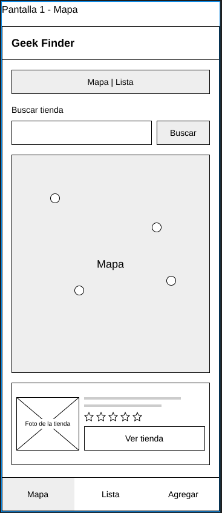
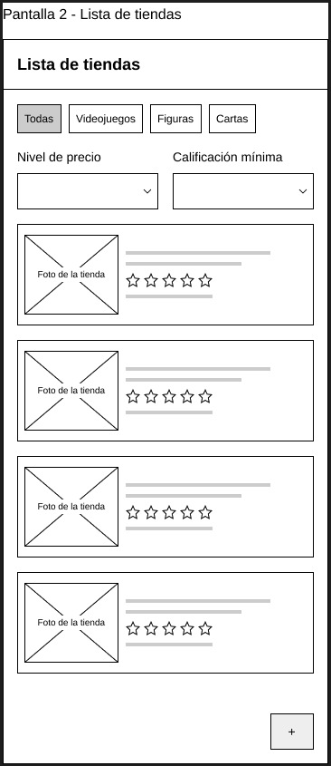
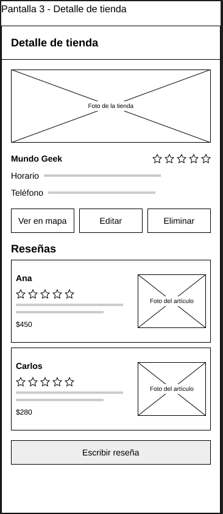
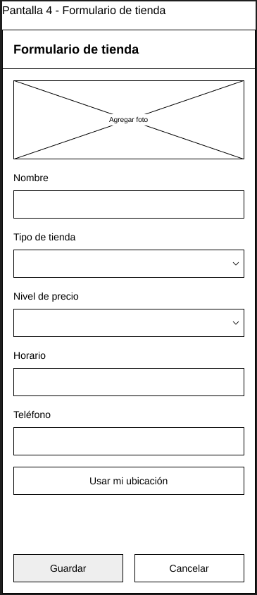
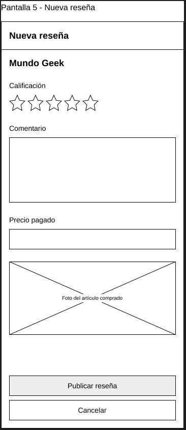
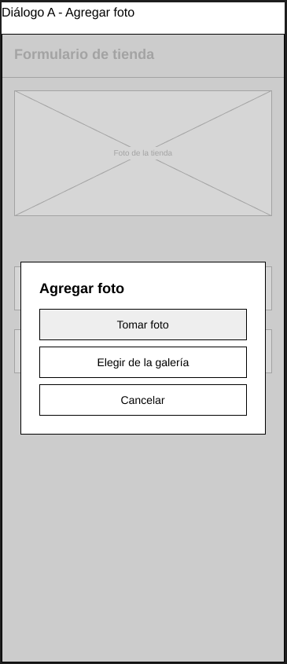
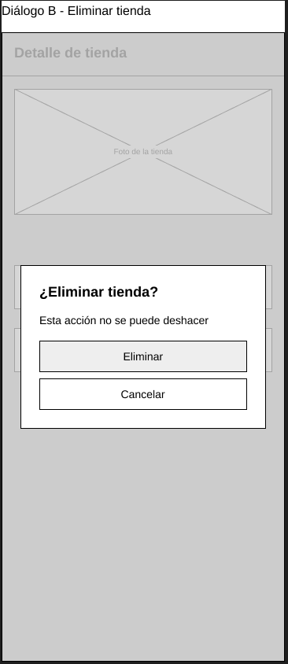

# Geek Finder

Mapa de tiendas de videojuegos, figuras y cartas. Es una aplicación movil pensada para la comunidad gamer
y coleccionista. La aplicación es un mapa de tiendas y puntos de interes relacionados en forma mapa colaborativo
ofreciondo una serie de filtros para encontrar en tu zona lo que se busca de forma rapida

La aplicación esta pensada para que encontrar el tipo de tiendas antes mencionado sea un trabajo menos laborioso
asi como contar con la reseña o opinion de otras personas con gustos similares pudiendo informarse generalmente de
la tienda a visitar tomando en cuenta rasgos como precios,variedad de articulos, etc... así propiamente los usuarios
podrian dejar su reseña acompañada del articulo que compraron para colaborar con los busquedas de articulos del resto
de usuarios.

## Integrantes del proyecto

    Minor Godoy Zuñiga

    Gerson Sosa Chavarría

## Diseño preliminar - Mockups

### Pantalla mapa

### Listado de tiendas

### Detalle de tienda

### Formulario tienda

### Nueva reseña

### Dialogo agregar foto

### Dialogo eliminar tienda

